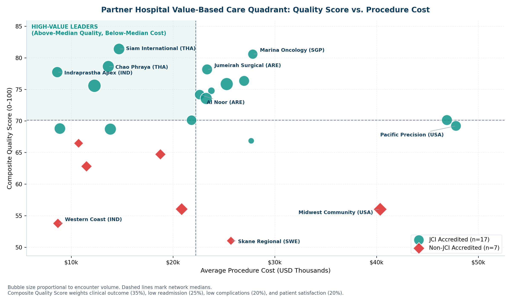
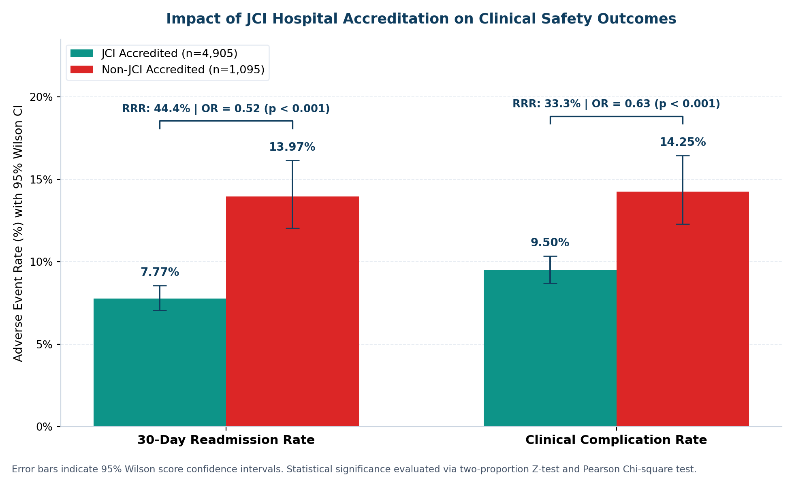
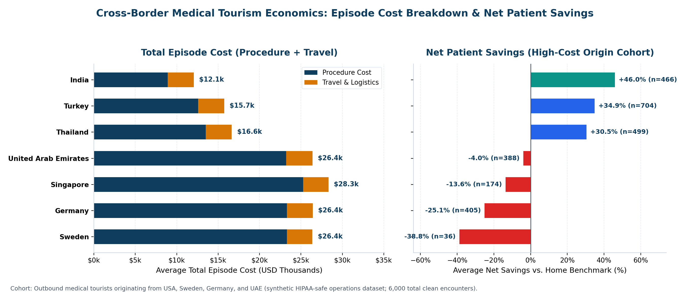
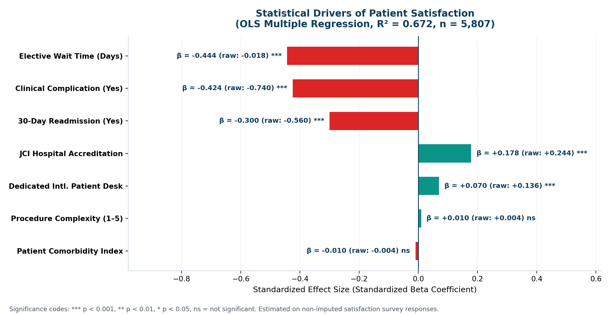
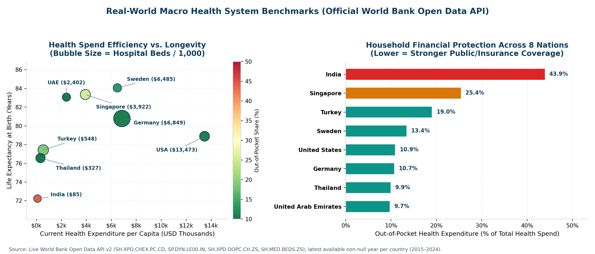
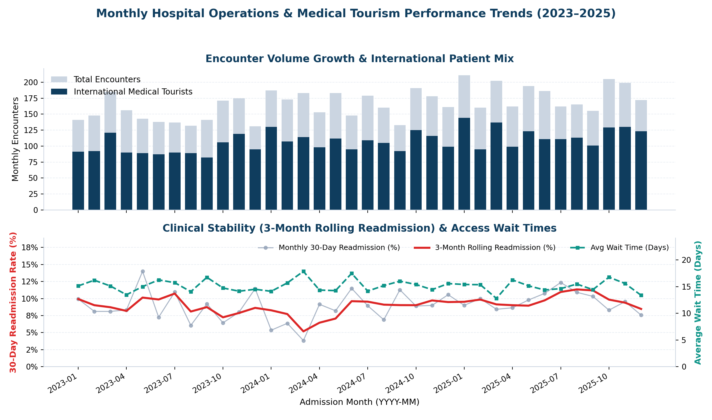

# Global Healthcare Operations & Medical Tourism Analytics

An end-to-end **SQL, Python, Statistical Modeling, Excel, and BI Analytics** platform built to evaluate international hospital performance, patient safety outcomes, cross-border medical tourism economics, and macro health-system benchmarks across **8 countries** (`UAE, Sweden, Germany, Turkey, Thailand, India, Singapore, USA`).

Designed to answer the core analytical questions faced by global healthcare platforms, partner hospital networks, and international patient advisory teams:
- *Which partner hospitals deliver the highest risk-adjusted clinical quality at transparent cost?*
- *Does JCI accreditation measurably reduce 30-day readmissions and clinical complications?*
- *Where do cross-border patients realize genuine net cost savings after travel and logistics?*
- *What operational bottlenecks drive patient satisfaction and length of stay?*

> **Data Transparency Note:** Macro country benchmarks (`640` rows, 2015–2024) are fetched live from the **official World Bank Open Data API v2**. Individual hospital encounter & billing feeds (`6,029` raw -> `6,000` clean episodes across `24` hospitals) are **deterministic, HIPAA/GDPR-safe synthetic operational data** with intentionally injected raw-feed defects to demonstrate real-world ETL cleaning and data-quality auditing. See [docs/data_governance_compliance.md](docs/data_governance_compliance.md).

---

## Key Quantitative Findings

| Analytical Question | Statistical Method | Verified Result |
| --- | --- | --- |
| **JCI Accreditation -> 30-Day Readmissions** | Two-Proportion Z-test & Chi-square | **7.77%** (JCI) vs. **13.97%** (Non-JCI) — **44.4% RRR** ($OR = 0.52, p = 7.0 \times 10^{-11}$) |
| **JCI Accreditation -> Complications** | Two-Proportion Z-test & Chi-square | **9.50%** (JCI) vs. **14.25%** (Non-JCI) — **33.3% RRR** ($OR = 0.63, p = 3.2 \times 10^{-6}$) |
| **Cross-Border Elective Wait Time** | Welch's t-test & Mann-Whitney U | Medical tourists **11.8 days** vs. Domestic **21.1 days** ($t = -25.19, p < 0.001$) |
| **Top US Outbound Net Savings** | SQL Corridor Aggregation | **India +63.3%** ($11.4k vs. $39.6k), **Turkey +58.9%**, **Thailand +52.6%** (incl. travel) |
| **Patient Satisfaction Drivers** | OLS Multiple Regression ($n = 5,807$) | **$R^2 = 0.672$** ($p < 0.001$); wait time ($\beta = -0.444$) & complications ($\beta = -0.424$) dominate |
| **Length of Stay Drivers** | OLS Multiple Regression ($n = 6,000$) | **$R^2 = 0.923$** ($p < 0.001$); clinical complications add ~**+2.4 hospital days** |
| **Real World Bank Macro Efficiency** | Live World Bank Open Data API v2 | **UAE** ($2,402/cap, **83.1 yrs**, **9.7% OOP**) & **Sweden** ($6,485, **84.1 yrs**) outperform **USA** ($13,473, 78.9 yrs) |

---

## Visual Highlights

### 1. Value-Based Care Quadrant: Partner Hospital Quality vs. Cost


### 2. Clinical Safety Impact of JCI Hospital Accreditation (95% Wilson CIs)


### 3. Cross-Border Medical Tourism Episode Economics & Net Savings


### 4. Statistical Drivers of Patient Satisfaction (OLS Regression)


### 5. Real-World Macro Health System Benchmarks (World Bank Open Data API)


### 6. Monthly Operations Volume, 3-Month Rolling Readmissions & Wait Times


---

## Architecture & Pipeline Deliverables

```text
World Bank Open Data API v2  ──┐
                               ├──> Python ETL + Data Quality Audit ──> SQLite Star Schema (8 Tables + 5 Views)
Multi-Source Raw CSV Feeds   ──┘         (Quarantine & ISO Cleanup)              │
                                                                                 ├──> SciPy / NumPy Statistical Suite
                                                                                 ├──> 6 Publication-Grade PNG Charts
                                                                                 ├──> Live-Formula Excel Workbook (.xlsx)
                                                                                 ├──> Interactive HTML BI Dashboard
                                                                                 └──> Power BI / Tableau CSV Exports
```

| Deliverable | Path | What It Demonstrates |
| --- | --- | --- |
| **Relational Star Schema & Views** | [sql/01_schema.sql](sql/01_schema.sql), [sql/02_views.sql](sql/02_views.sql), [sql/03_analytical_queries.sql](sql/03_analytical_queries.sql) | Normalized dimensions/facts, foreign keys, `CHECK` constraints, CTEs, window functions (`DENSE_RANK`, `LAG`, `AVG() OVER`, `ROW_NUMBER`). |
| **Multi-Source ETL & DQ Audit** | [src/etl_pipeline.py](src/etl_pipeline.py) | Deduplicates `18` duplicate episodes, fixes `300` mixed dates & `266` country aliases, quarantines `11` FK/range defects, logs `10` automated audit checks. |
| **Statistical & Regression Suite** | [src/statistical_analysis.py](src/statistical_analysis.py) | Z-tests, Chi-square, Odds Ratios, Wilson CIs, Welch t-test, Mann-Whitney U, ANOVA, Kruskal-Wallis, OLS regressions, IQR/Z-score billing anomaly audit, 2,000-sample Bootstrap CIs. |
| **Executive Excel Workbook** | [reports/Healthcare_Operations_Analytics_Workbook.xlsx](reports/Healthcare_Operations_Analytics_Workbook.xlsx) | 5 formatted tabs with **live Excel formulas** (`SUM`, `COUNTIF`, `AVERAGEIF`, `RANK`, composite score formula), conditional color scales, and native Excel chart. |
| **Interactive BI Dashboard** | [dashboard/index.html](dashboard/index.html) | Zero-dependency executive dashboard with live filtering by Country, JCI Accreditation, and Hospital Tier + interactive SVG quadrant chart. |
| **Data Model & Governance Docs** | [docs/data_model.md](docs/data_model.md), [docs/executive_brief.md](docs/executive_brief.md), [docs/data_governance_compliance.md](docs/data_governance_compliance.md) | Mermaid ERD, Power BI / Tableau guide, non-technical executive brief, and HIPAA / EU GDPR / UAE Federal Health Data Law compliance notes. |
| **Automated Test Suite** | [tests/test_pipeline.py](tests/test_pipeline.py) | `pytest` verification of schema FK integrity, ETL cleaning guarantees, view counts, statistical validity, Excel formulas, and dashboard build. |

---

## Reproducing the Full Pipeline

```bash
# 1. Clone and create virtual environment
git clone https://github.com/boostx1/global-healthcare-operations-analytics.git
cd global-healthcare-operations-analytics
python3 -m venv .venv
source .venv/bin/activate
pip install -r requirements.txt

# 2. Run the entire end-to-end pipeline (add --refresh-worldbank to re-fetch live API data)
python src/run_all.py

# 3. Run automated verification tests
pytest -v
```

Open `dashboard/index.html` in any browser to explore the interactive BI dashboard, or open `reports/Healthcare_Operations_Analytics_Workbook.xlsx` in Microsoft Excel / LibreOffice Calc.

---

## Author

**Subhi Alloush** — M.Sc. Engineering Student in AI & Machine Learning (Blekinge Institute of Technology, Sweden)
[LinkedIn](https://www.linkedin.com/in/subhi-alloush-aa4001352/) · [GitHub](https://github.com/boostx1)
