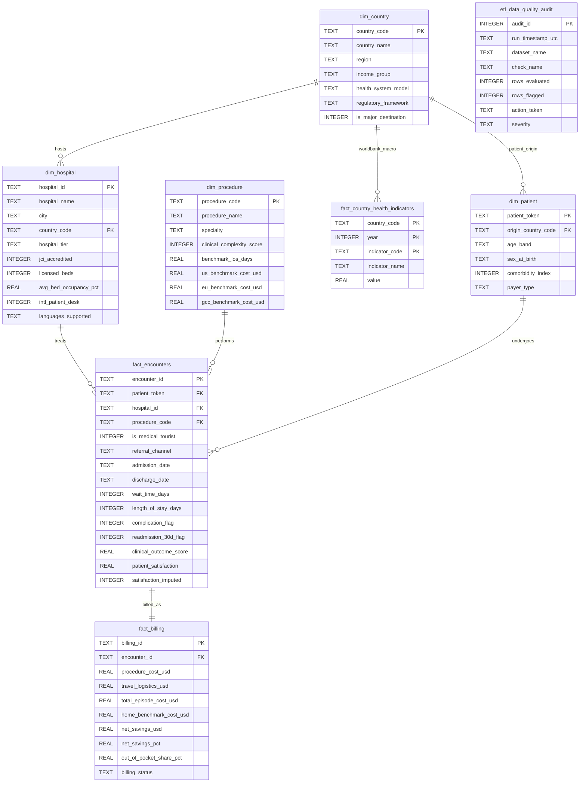

# Relational Data Model & BI Integration Guide

## 1. Star-Schema Entity-Relationship Diagram (ERD)

## 2. Table Grains & Modeling Decisions

| Table / View | Grain | Primary Key | Notes |
| --- | --- | --- | --- |
| `dim_country` | 1 row per ISO-3 nation | `country_code` | Covers 8 destination hubs and origin markets (`ARE, SWE, DEU, TUR, THA, IND, SGP, USA`). |
| `dim_hospital` | 1 row per partner facility | `hospital_id` | 24 hospitals across Quaternary, Tertiary, and Specialty tiers; tracks JCI accreditation & capacity. |
| `dim_procedure` | 1 row per standardized procedure | `procedure_code` | 12 high-volume cross-border procedures with complexity ratings and regional benchmark costs. |
| `dim_patient` | 1 row per de-identified patient | `patient_token` | SHA-256 salted synthetic token (`PT-...`); age stored as bands only (zero PII). |
| `fact_encounters` | 1 row per clinical episode | `encounter_id` | 6,000 validated encounters (2023–2025). Includes `satisfaction_imputed` flag for analytical transparency. |
| `fact_billing` | 1 row per encounter invoice | `billing_id` | 1:1 with `fact_encounters` via unique `encounter_id`; separates clinical vs. travel logistics costs. |
| `fact_country_health_indicators` | 1 row per country-year-indicator | `(country_code, year, indicator_code)` | 640 live observations from World Bank Open Data API v2 (2015–2024). Reporting-lag NULLs preserved. |
| `etl_data_quality_audit` | 1 row per automated ETL check | `audit_id` | Full lineage of deduplication, standardization, quarantine counts, and imputation. |

## 3. Power BI / Tableau Quick-Connect Setup

All normalized dimension tables, fact tables, and pre-aggregated views are exported cleanly to `data/bi_exports/`:

1. **Power BI Desktop:** `Get Data -> Folder -> data/bi_exports/` (or import the 4 `dim_*.csv` + 3 `fact_*.csv` files directly). Relate `country_code`, `hospital_id`, `procedure_code`, `patient_token`, and `encounter_id` in Model View using the Star Schema above.
2. **Tableau Desktop / Public:** Connect to `fact_encounters.csv` and drag `fact_billing.csv`, `dim_hospital.csv`, `dim_procedure.csv`, `dim_patient.csv`, and `dim_country.csv` into the logical layer on their matching primary/foreign keys.
3. **Excel:** Open `reports/Healthcare_Operations_Analytics_Workbook.xlsx` directly — all KPI rollups, composite scores, ranks, and corridor savings use live Excel formulas.
